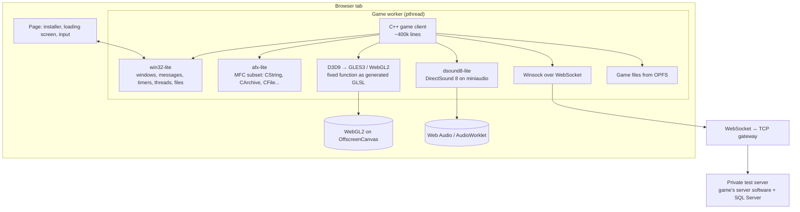
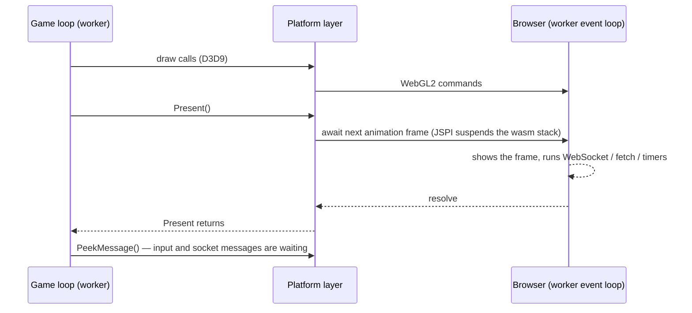
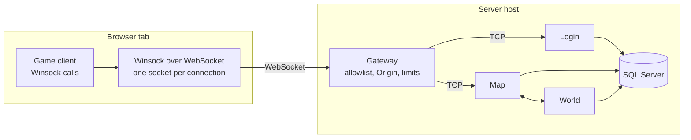

# Porting a 400,000-line Windows MMORPG to the browser, multiplayer included

A few weeks ago I set myself a question: can a 2000s Windows MMORPG client run in a browser tab, essentially unchanged, and play online? Not a remake, not a video stream of a PC somewhere, not an x86 emulator. The game's own C++ code, compiled to WebAssembly, talking to the game's own server software, with several players in the same world. The server is a private test instance on my PC, never the official servers.

It can. This is how we did it, what broke along the way, and what we measured. "We" is me plus a team of AI coding agents, and that part of the story is in here too.

> The Direct3D 9 layer of this work, **Portico**, runs Direct3D 9 C++ programs in the browser from source. It is [open source under MPL-2.0](https://github.com/matteodante/portico); the [live demo](https://matteodante.it/portico-demo/index.html) runs Microsoft's DirectX tutorials unchanged.

> **About this project.** A personal, non-commercial research project on porting legacy software, written up to describe the engineering. The game is not named and is **not distributed in any form**: no source code, no WebAssembly build, no game assets, no installer. Every server in this article is a **private test instance** of the game's server software running on my own PC, with test accounts only: not the official servers, not connected to them and not open to the public. I am not affiliated with the game's developer or publisher, and all rights to the game belong to their owners.

## The starting point

The client is a typical PC game of its era:

- about **400,000 lines of C++** in 396 source files, built with Visual C++;
- **MFC** for strings, files, serialization and the application skeleton;
- **Win32** for windows, messages, timers, threads, critical sections and the registry;
- **Direct3D 9** with the fixed-function pipeline: no shaders, just render states, texture stages and lights;
- **DirectSound 8** with 3D positional audio;
- **Winsock** with `WSAAsyncSelect`, so network events arrive as window messages;
- a game loop that never returns: `PeekMessage`, update, draw, `Present`, repeat.

For multiplayer testing, the client connected to the game's native Windows server software (Login, World, Map and Control, backed by SQL Server), running locally on my PC. The browser-to-server network path is described below.

The rules I set:

1. **Preserve the original architecture.** Keep the compatibility work in a separate platform layer wherever possible.
2. **No streaming and no emulation.** The client runs in the browser as WebAssembly.
3. **The game must stay runnable at every step**, and every claim is checked against the real game, not a toy.

## Choosing the approach

There are four ways to put an old Windows game in a browser.

| Approach | How it works | Why not (for us) |
|---|---|---|
| Streaming | Run the .exe on a server, send video | Latency, server cost, it's not *in* the browser |
| Rewrite | New client in a web engine, same protocol | Years of work, and it's no longer the same game |
| Binary emulation | Run the unmodified .exe on an emulated x86 with reimplemented Windows APIs (BottleShip, Boxedwine) | Great when you only have binaries; we had source |
| **Source port over an API layer** | Compile the game's C++ with Emscripten, implement the Windows APIs it calls | Lots of API surface to reimplement, but only what the game actually uses |

We went with the last one. The first prototype tried a different idea: reimplement the renderer in Three.js and compile isolated parts of the game into separate WebAssembly modules. An independent audit put its real progress at about 5%. Each module had its own heap and its own copy of the Windows stubs, and the stubs disagreed with each other. We threw it away and started over with one rule: **one client, one heap, one platform layer**.

## The platform layer

Everything the game expects from Windows lives in about 21,000 lines of our own code:

- **win32-lite** implements the windowing and message queue, timers, threads, events and critical sections, files, the registry, code pages, IME input and the CryptoAPI calls the game uses. It started from an automatic list: every Windows symbol the linker could not find became a stub that logs its first call. The work list was simply what the game really called, in the order it called it.
- **afx-lite** is the slice of MFC the game uses: `CString`, `CFile`, `CArchive`, runtime classes, `CWinApp`, message maps. `CArchive` is checked byte for byte against real MFC.
- **The Direct3D 9 layer** turns the fixed-function pipeline into GLSL ES 3.00 programs, one per combination of states: up to 8 lights, 8 texture stages, vertex blending, fog modes, multiple vertex streams. A command queue preserves the ordering that `D3DCREATE_MULTITHREADED` promises, because the game's loader thread draws the loading screen while the main thread waits for it.
- **dsound8-lite** implements DirectSound 8 on miniaudio, including 3D sound. Its pan and attenuation model was **measured on real DirectSound** on a Windows PC and reproduced, not guessed.
- **Networking** maps Winsock, including `select` and `WSAAsyncSelect`, onto one WebSocket per connection, and a small gateway forwards each one to its TCP server ([below](#the-servers-and-the-network-path)).
- **File access** uses the browser's Origin Private File System, with a manifest, integrity checks, resumable transfers and atomic updates in the private test setup. The client reads resources through Emscripten's WasmFS as if they were on disk.

### Graphics: native first, then the browser

The single best decision of the project was to **validate the graphics layer against the native Windows build first**. The same D3D9-to-GLES3 code runs in the Windows build over ANGLE (Google's GLES implementation, the one Chrome uses to run WebGL on Windows) in WebGL-compatibility mode. So we could switch the same executable between real Direct3D 9 and our layer, take screenshots of the same scene with both, and compare them.

The comparison is tile-based. Each screenshot is split into tiles, and a tile fails only if it differs in a way you would actually notice. For animated scenes, it compares against the nearest frame in a short D3D9 recording. In the final runs, the difference from real Direct3D 9 averages 0.4 to 3.1 on a 0–255 scale across the reference scenes, and what's left is text rendering, animation timing and the moment the screenshot was taken.

Developing natively also gave us a debugger, RenderDoc and a fast edit-compile-run loop. And a surprise: on the development PC the game ran its 3D world at **4–6 fps on the system's Direct3D 9** (it switches between hardware and software vertex processing for every mesh) and at **78–90 fps on our layer** in the same executable.

## The runtime model: a loop that never returns

A browser wants your code to return to its event loop every frame. A 2000s game does the opposite: its main loop runs forever, and it also blocks on purpose, with `Sleep`, `WaitForSingleObject` and a loader thread it waits for.

We kept the game's model intact:

- The whole client runs on a **worker thread** (Emscripten's `PROXY_TO_PTHREAD`), so blocking calls block the worker and never freeze the page.
- The WebGL2 context lives on that same worker through an **OffscreenCanvas**, so the game's draw calls never cross threads.
- After every `Present`, the layer **yields to the worker's event loop** using **JSPI** (WebAssembly JavaScript Promise Integration). The game's call stack is suspended, the browser shows the frame and delivers network and file events, and the call returns at the next animation frame. From the game's point of view, `Present` just took a few milliseconds.

We tried the alternatives first:
- rewriting the loop as a per-frame callback would have meant changing the game;
- Emscripten's commit-frame call did nothing in Chrome;
- proxying GL to the page deadlocked against the loader thread;
- Asyncify would have instrumented a 400,000-line program.

JSPI does exactly what we needed with no change to the game. It shipped in Chrome and Edge 137, Firefox 153 and, in September 2026, Safari 27.

## The servers and the network path

Multiplayer was the point: browser tabs and the Windows client playing together in the same world, on the same server software. Here that server is a private test instance on my PC, not the game's official one.

**The private test servers.** The server environment ran locally on Windows. In a load test with 100 moving bots over 90 seconds, it recorded no disconnections, a 95th-percentile login of 467 ms and map-server memory use of 80 MB.

**No TCP in a browser.** The client talks to its servers over TCP with Winsock, and a browser only has WebSockets. We compared three ways across:

- Emscripten's socket emulation does not exist with WasmFS, the file system we use: every socket call fails. With the older file system it also rejects a socket option the game sets before connecting.
- Emscripten's POSIX socket proxy sends socket calls to a native helper and blocks the game until it answers; it has no `select` and no non-blocking sockets, and it is an open proxy anyone could use.
- Our own **Winsock over WebSocket** in the platform layer, about 300 lines, with the behaviour the game expects from Windows.

We built the third. A non-blocking `connect` completes when the TCP connection behind it does. `WSAAsyncSelect` events arrive as window messages each time `PeekMessage` yields to the browser, with the Windows rules: `FD_READ` again only after a `recv`, `FD_CLOSE` only once the data has been read. One detail mattered more than it looks: socket handles rotate instead of reusing the lowest free number. The game closes its Login connection and immediately opens the Map one, and a late `FD_CLOSE` for the first would otherwise have closed the second.

**The gateway.** A small Node.js server with a single dependency turns each WebSocket into a TCP connection:

- it completes the WebSocket handshake only once the TCP connection is up, so for the client "open" really means "connected", and a refused or silent server becomes a failed `connect`, as on Windows;
- bytes pass through untouched: the game's own encryption and packet framing never change;
- an allowlist maps the addresses the game knows (the Login from its command line, the Map address the Login sends) to the test servers; anything else is refused before a connection is made, and the World, Control and database servers are never reachable from outside;
- it checks the page's Origin, limits connections per IP and handshakes per minute, and logs every connection but never its payload, which contains the login.

Data from the network reaches the game at its next yield, once per frame, which is also when the native client reads its sockets: once per turn of its loop. The same gateway served the native client first, through a small TCP-to-WebSocket tunnel, so the whole path was tested with the real game before the browser build could log in. The servers run only on my PC: my other devices reach them over a private network, and nothing is exposed to the internet.

## War stories

**Compiler compatibility.** MFC's `CString` behaves differently in variadic calls under MSVC and Clang. Tests against real MFC helped establish what the browser build needed to preserve, without relying on compiler flags that changed the text or leaked memory.

**Loading in 80 seconds, then in 8.** The first browser build took 80 seconds to reach the login screen. MFC's `CArchive` reads files in buffered blocks, and our first version read byte by byte through WasmFS. Matching MFC's buffering, plus read-ahead in `CFile`, brought it to 8 seconds, and entering the world dropped from 14–18 seconds to 0.4. Later, reading game files from OPFS in large blocks took the complete player experience, from clicking "Play" to the login screen, from 35–55 seconds down to 16–20.

**From 50 fps to the display rate.** The first working build ran at 50–60 fps. The fix was to present every finished frame, paced by the display, and to stop keeping CPU copies of resources the game never reads back (the city scene went from 335 MB of copies to 25 MB). After that the login screen ran at **277–280 fps**, the refresh rate of the 279 Hz monitor, and the world at 150–250 fps. A cache of GL bindings later took one Firefox scene from 75 to 164 fps.

**The unfair lock.** For a while, Chromium sometimes froze at the login screen and Firefox never did. The cause was our `EnterCriticalSection`: a plain mutex lets the thread that releases it take it again straight away, so the main thread kept winning while the loader thread starved. The game, written against Windows, never expected that. A ticket lock, which serves waiters in arrival order, fixed it, and the test suite now measures the worst wait.

**Memory.** At the end of loading the client's WebAssembly heap is about 820 MB. That's fine on a desktop, and it's the main obstacle on an iPhone, where Safari closes a page that grows past a budget of a few hundred megabytes to about a gigabyte, without an error. That's the next problem to solve.

## Testing a whole game

Unit tests don't tell you whether a game works. What we used instead:

- **Automated game scenarios** for login, character selection, movement, combat and two-player interactions. Each reports `RESULT ok` or `RESULT fail: <reason>`.
- **A suite with one command**: input, locks, page behavior, login, character selection, town, combat and two browsers meeting each other, in headless Chromium and Firefox on the real GPU, with screenshot parity against Direct3D 9 for every scene. The final run: **13 of 13**, and the two-player check **14 of 14** (each player sees the other and reads their chat line).
- **Game systems end to end against the test server and its database**, with the client in the browser and a second one native at the same time:
  - combat, skills (including the server refusing a skill used before its cooldown ends), inventory and equipment, leveling up;
  - quests, NPC shops, mail, trading between players, parties and guilds;
  - entering and leaving a dungeon through its portal, a duel, a fort war;
  - after each run the database must hold exactly the state the client last showed. A full restart of servers and database must lose nothing.

  Each test prepares its characters from SQL first, so the runs can be repeated.

## How it was built

The port, from the moment a coordinating session took over to the closing verification, took **nearly 600 commits in about 32 hours**. I didn't write most of that code. I coordinated a team of AI coding agents (Claude, in Claude Code), each working as a separate **lane** with its own worktree, folder and job:

| Lane | Job |
|---|---|
| graphics | the D3D9 layer and screenshot parity |
| wasm base and test bench | the browser build and the test suite |
| networking | the gateway and the installer |
| text and game systems | fonts, then the end-to-end tests |
| autopilot and audio | the scripted scenes and DirectSound |

A coordinator session merged each verified step into `main` and kept a single status file.

What made it work:

- **Objective measures only.** Progress was counted in milestones reached, scenes matching Direct3D 9, files compiling to wasm32 and game systems green against the test server. Never in the number of checks or documents. The first prototype had looked busy and was at 5%.
- **Everything verified on the real game.** No "it should work": a build, a scene, a log line, a database row.
- **Independent review, verified.** At the end of every large piece, a second model (OpenAI's Codex) reviewed the change adversarially. Its findings were **checked against the cited code before being accepted**, because a confident review is often wrong. In the last two reviews, 13 findings were checked: 10 were real and resolved, 1 was rejected, and 2 were recorded for later.
- **Small details written down, not chased.** The goal came first.

What didn't work as well: parallel lanes sometimes fixed the same thing twice, a shared gateway port went down under another lane's test, and a few results were claimed before they were checked. The fix was always the same: a single owner per folder, one test account per lane, and re-running the claim on the coordinator's side before merging.

## What's next

The reusable part of this work is **Portico**, an [open-source library under MPL-2.0](https://github.com/matteodante/portico). Its Direct3D 9 to WebGL2 layer runs Microsoft's open-source DirectX samples unchanged ([live demo](https://matteodante.it/portico-demo/index.html)) and is tested against Windows Direct3D 9. It also includes D3DX math and texture loading and a Win32 subset for Emscripten. Broader Win32 support, MFC, DirectSound, networking and the file installer remain planned modules. If you have an old Win32 or Direct3D 9 program you would like to see in a browser, [get in touch](mailto:matteo.dante659@gmail.com).

The game is not distributed in any form, and won't be: not its source code, not the WebAssembly build, not its assets, not an installer, and its servers stay a private test instance. It isn't mine to share, and the point was never this particular game: it was finding out whether twenty-year-old software can simply *run* in the browser.

It can.

## Links

- [Portico on GitHub](https://github.com/matteodante/portico): the Direct3D 9 layer of this port, open source under MPL-2.0.
- [Live demo](https://matteodante.it/portico-demo/index.html): Microsoft's DirectX tutorials running in the browser through Portico.
- [The Portico story](portico-direct3d9-webgl2.md): why the layer was extracted and how its output is checked.
